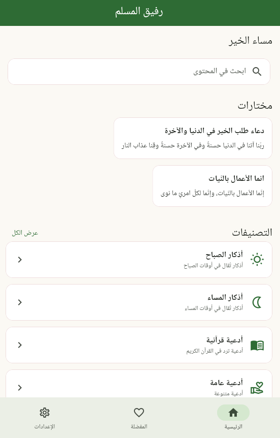
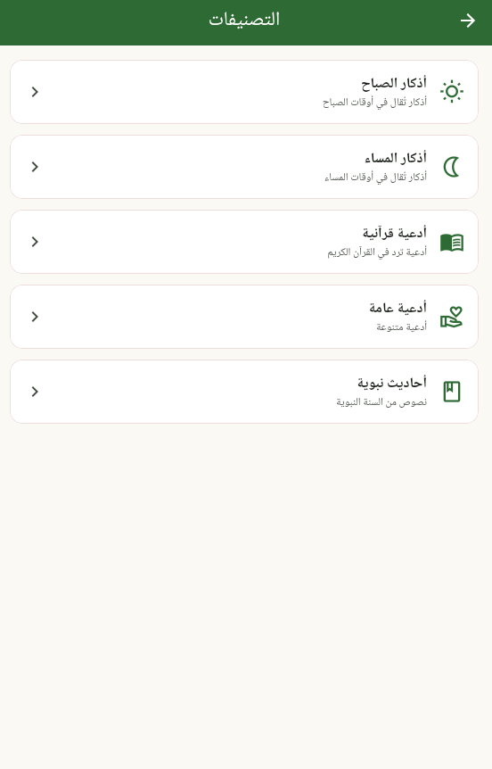
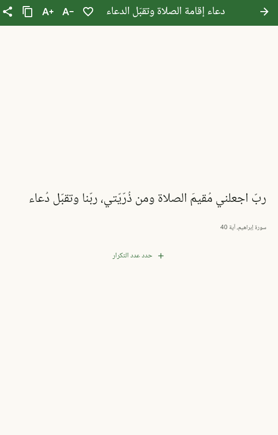
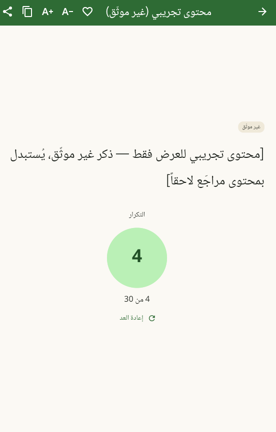
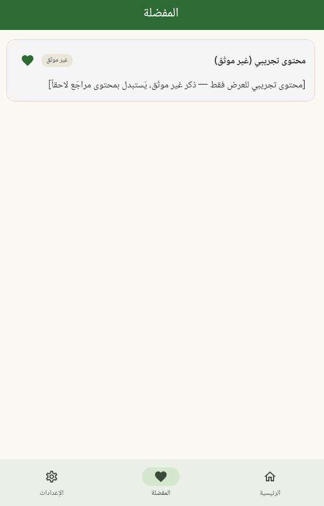
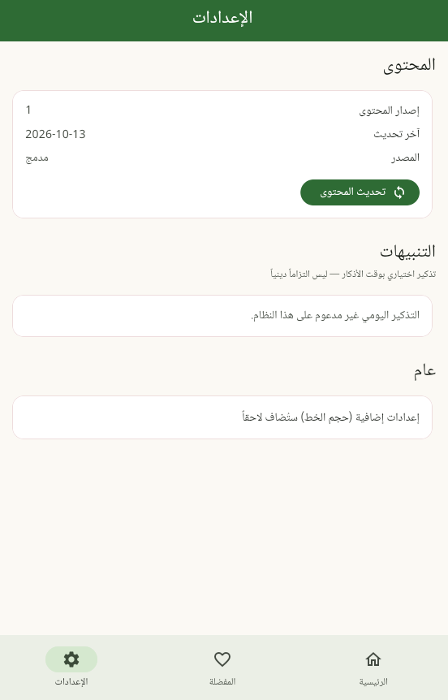

<div dir="rtl" align="center">


# رفيق المسلم — The Muslim's Companion

*A free, ad-free Arabic app for duas, hadiths and adhkar.*

[Get Started](#getting-started) · [Features](#features) · [Roadmap](#project-status) · [Contributing](#contributing)

<br>


</div>

---

**رفيق المسلم** ("The Muslim's Companion") is a **Flutter** app with an
**Arabic-only, right-to-left** interface built on **Material 3**. It is made for
anyone who wants a simple, offline-first companion for daily Islamic reading —
no account, no clutter, no ads.

All content is **bundled with the app as JSON** in [`assets/data/`](assets/data/)
and served through a local repository. There is **no backend, no login, no
analytics, and no ads.** Remote content updates and an offline cache are wired in
but still point at a placeholder host (see [Project Status](#project-status)).

---

## Screenshots

> The app currently ships a single light theme (`AppTheme.light()`) — there is no
> dark mode yet, so no dark-mode screenshot is shown.

<table>
  <tr>
    <td align="center" width="220">
      <br>
      <sub><b>Home</b></sub>
    </td>
    <td align="center" width="220">
      <br>
      <sub><b>Categories</b></sub>
    </td>
    <td align="center" width="220">
      <br>
      <sub><b>Dua detail</b></sub>
    </td>
  </tr>
  <tr>
    <td align="center" width="220">
      <br>
      <sub><b>Adhkar counter</b></sub>
    </td>
    <td align="center" width="220">
      <br>
      <sub><b>Favorites</b></sub>
    </td>
    <td align="center" width="220">
      <br>
      <sub><b>Settings</b></sub>
    </td>
  </tr>
</table>

---

## Features

Everything below is implemented and covered by tests:

- [x] **Categorized content** — duas, hadiths and adhkar, bundled as JSON
      (`assets/data/`: 5 categories, 3 duas, 2 hadiths, 5 adhkar)
- [x] **Search** — fuzzy text search across every bundled entry
- [x] **Favorites** — toggle and persist favourites locally
- [x] **Copy & share** — copy to clipboard or share via the system sheet
- [x] **Adhkar counter** — tap-to-count with a user-defined target per entry
- [x] **Adjustable font size** — step up/down while reading, clamped to sane limits
- [x] **Optional daily reminders** — scheduled locally (Android & Windows;
      the Linux plugin lacks scheduling, so the card is hidden there)

---

## Project Status

| Milestone | State |
| --------- | ----- |
| Bundled content (duas, hadiths, adhkar) | ✅ Done |
| Search | ✅ Done |
| Favorites | ✅ Done |
| Daily reminders | ✅ Done *(Android / Windows; not Linux)* |
| Adhkar counter | ✅ Done |
| Copy & share | ✅ Done |
| Remote content updates | 🚧 In progress — code wired, awaiting a real content host (`kContentBaseUrl` is a placeholder) |
| Offline content cache | 🚧 In progress — implemented, tied to remote content updates |

**Last updated:** 2026-10-13 (content `manifest.json` `updatedAt`)

---

## Getting Started

### Setup

1. Install the Flutter SDK (stable channel, 3.47+ tested). Example for Linux:

   ```bash
   # ~/flutter is used throughout this project; adapt if you install elsewhere.
   wget https://storage.googleapis.com/flutter_infra_release/releases/stable/linux/flutter_linux_3.47.7-stable.tar.xz
   tar xf flutter_linux_3.47.7-stable.tar.xz   # extracts to ~/flutter
   echo 'export PATH="$HOME/flutter/bin:$PATH"' >> ~/.bashrc
   source ~/.bashrc
   ```

2. Verify the toolchain:

   ```bash
   flutter doctor
   ```

### Run

```bash
flutter pub get
flutter run            # on a connected device/emulator
```

### Checks

```bash
dart format .
flutter analyze
flutter test
flutter build apk --debug   # requires the Android toolchain from flutter doctor
```

---

## Contributing

Contributions are welcome — bug fixes, content corrections, and tests.

```bash
git clone git@github.com:yahyaouifaouzi/the-muslims-companion.git
cd the-muslims-companion
flutter pub get
flutter test
```

Please open a PR against `main` and make sure `dart format .`,
`flutter analyze`, and `flutter test` all pass.

### Content rule

Islamic content is treated with care. By contributing you agree that:

- **Religious text and attributions are never invented.** Every dua, hadith and
  dhikr is **verbatim from the JSON** in [`assets/data/`](assets/data/).
- **Diacritics are never changed** on displayed or shared Arabic text.
- Unverified entries are clearly labelled and excluded from production until
  verified.

See [`docs/CONTENT_SCHEMA.md`](docs/CONTENT_SCHEMA.md) for the data format.

---

## Project Layout

Feature-oriented; grows per milestone.

```
lib/
  main.dart            # app shell: Arabic locale, RTL, Material 3 theme wiring
  app/                 # stores: favorites, counter, reminders, notifications
  content/             # local repository + models + remote refresh/cache
  ui/screens/          # home, categories, reader, search, favorites, settings
  ui/widgets/          # cards, counter section, state views
assets/data/           # bundled JSON content
assets/fonts/          # bundled Noto Naskh Arabic (OFL)
docs/                  # plan, schema, publishing, release checklist
```

### Conventions

- **Arabic-only UI; RTL always.** Use Directionality-aware APIs
  (`EdgeInsetsDirectional`, `AlignmentDirectional`, start/end alignment) —
  do not hardcode left/right offsets.
- Never modify displayed/shared Arabic diacritics. Content verbatim from JSON.
- No backend, no database, no login, no analytics, no ads in the MVP.
- Religious text and attributions are never invented; unverified placeholders
  are clearly labelled and excluded from production until verified.

---

## License

Released under the [MIT License](LICENSE).

---

## Security

To report a vulnerability, see [SECURITY.md](SECURITY.md). Please report
privately via GitHub Security Advisories rather than a public issue.

<div dir="ltr" align="center">
<sub>Built with Flutter · Content served locally · No trackers, ever.</sub>
</div>
